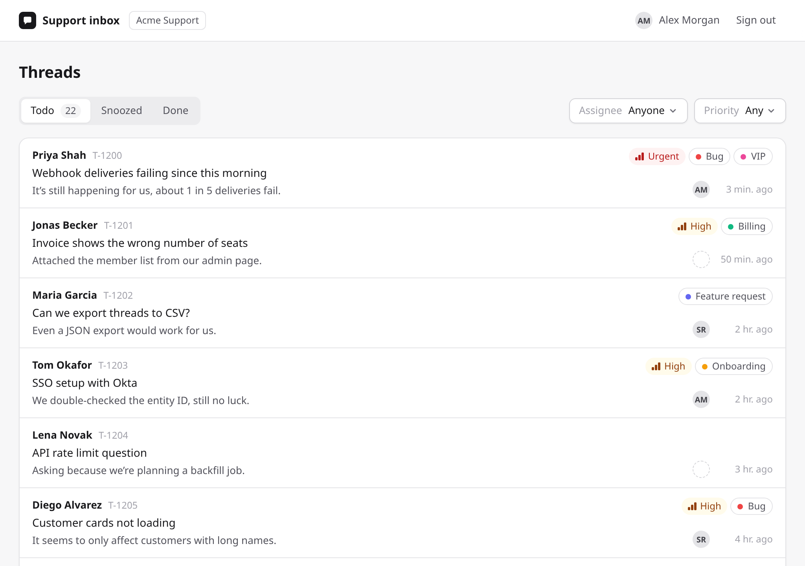
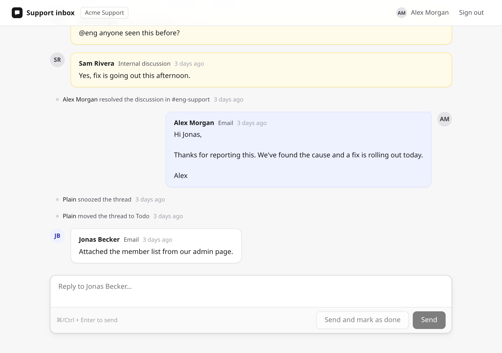
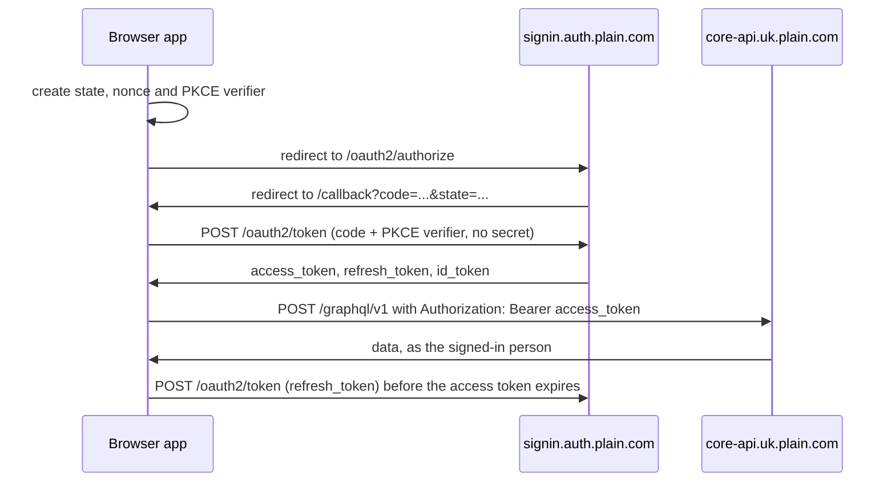

# Plain OAuth support inbox example

A small support inbox that teammates sign in to with their Plain account. Once signed in you can:

- browse your workspace's thread queue and filter it by status, assignee and priority
- open a thread and read its timeline
- reply to the customer
- mark the thread as done

It runs entirely in the browser. There is no backend: the app does the OAuth sign-in itself and calls [Plain's GraphQL API](https://www.plain.com/docs/graphql/introduction) directly with the signed-in person's access token. Every call runs as that person, with the permissions their role in Plain already has.





The point of the example is the Plain parts: [OAuth](#how-sign-in-works) and [the API calls](#the-api-calls). The rest is a deliberately ordinary [Vite](https://vite.dev) + React app with few dependencies:

- [`oidc-client-ts`](https://github.com/authts/oidc-client-ts) and [`react-oidc-context`](https://github.com/authts/react-oidc-context) for OAuth
- [`react-router`](https://reactrouter.com) for routing
- CSS Modules for styling

## Running it

You need Node 22.22 or later and a Plain workspace.

### 1. Create an OAuth app in Plain

In Plain, go to **Settings → OAuth applications** and click **Add OAuth app**.

- **App name:** shown to people when they sign in, for example "Support inbox".
- **Redirect URLs:** `http://localhost:5173/callback`. Add your production URL too when you deploy, for example `https://inbox.example.com/callback`.

Make it a **public client**, which uses PKCE and has no client secret. A browser app can't keep a secret, so this example never uses one.

Copy the **client ID**.

### 2. Configure and start the app

```bash
cp .env.example .env.local
# Set VITE_PLAIN_OAUTH_CLIENT_ID in .env.local
npm install
npm run dev
```

Open [http://localhost:5173](http://localhost:5173) and click **Sign in with Plain**.

| Variable | Required | Purpose |
| --- | --- | --- |
| `VITE_PLAIN_OAUTH_CLIENT_ID` | Yes | Your OAuth app's client ID. |
| `VITE_PLAIN_API_URL` | No | GraphQL endpoint. Defaults to `https://core-api.uk.plain.com/graphql/v1`. |
| `VITE_PLAIN_AUTH_URL` | No | OAuth authorization server. Defaults to `https://signin.auth.plain.com`. |
| `VITE_PLAIN_APP_URL` | No | Plain's web app, used for "Open in Plain" links. Defaults to `https://app.plain.com`. |

Vite bundles every `VITE_` variable into the JavaScript it sends to the browser, so treat them all as public. A client ID is public by design; **never put a client secret or API key in a `VITE_` variable.**

## Where to look

| File | What it shows |
| --- | --- |
| [`src/auth.ts`](src/auth.ts) | The whole OAuth configuration: authority, client ID, redirect URL, scopes, refresh and nonce. |
| [`src/main.tsx`](src/main.tsx) | `AuthProvider` wiring. It completes the sign-in when Plain redirects back. |
| [`src/routes/RequireAuth.tsx`](src/routes/RequireAuth.tsx) | Protecting pages, and refreshing a token that expired while the tab was asleep. |
| [`src/components/AppShell.tsx`](src/components/AppShell.tsx) | Loading the signed-in person and workspace with `myUser` and `myWorkspace`, and signing out. |
| [`src/plain/client.ts`](src/plain/client.ts) | `plainRequest()`, the only function that calls the API, and how query errors are handled. |
| [`src/plain/operations.ts`](src/plain/operations.ts) | Every GraphQL query and mutation the app uses, with TypeScript types for each. |
| [`src/plain/hooks.ts`](src/plain/hooks.ts) | Passing the access token to each call, and signing out when Plain rejects it. |
| [`src/routes/Queue.tsx`](src/routes/Queue.tsx) | Turning URL filters into Plain's `ThreadsFilter`, and cursor pagination. |
| [`src/routes/Thread.tsx`](src/routes/Thread.tsx) | Loading a timeline, replying, marking as done, and showing mutation errors. |

## How sign-in works

The app uses the OAuth 2.0 authorization code flow with PKCE, against Plain's authorization server at `https://signin.auth.plain.com`. The server's settings are in its [discovery document](https://signin.auth.plain.com/.well-known/openid-configuration).



1. **Sign in.** "Sign in with Plain" calls `signinRedirect()`.
   - `oidc-client-ts` creates a random `state` and a PKCE code verifier, and stores both in `sessionStorage`.
   - It sends the browser to `/oauth2/authorize` with `scope=openid offline_access`. `offline_access` is what gets you a refresh token.
   - Plain requires a `nonce`, which we generate with `crypto.randomUUID()`.
2. **Callback.** Plain redirects back to `/callback?code=...&state=...`.
   - `AuthProvider` checks `state` and exchanges the code at `/oauth2/token` with the PKCE verifier. No client secret is involved.
   - It rejects an ID token whose `nonce` doesn't match.
3. **Calling the API.** Every GraphQL request sends `Authorization: Bearer <access_token>`, exactly like an API key. Plain runs the call as the person who signed in.
4. **Staying signed in.** Shortly before the access token expires, `automaticSilentRenew` swaps the refresh token for a new access token. If the tab slept past expiry, [`RequireAuth`](src/routes/RequireAuth.tsx) refreshes it once on the next page load.
5. **Signing out.** Sign-out deletes the tokens from this browser. Plain's authorization server has no revocation or end-session endpoint, so the deleted access token would keep working until it expires.

If Plain rejects a token (it expired, or the OAuth app was turned off or deleted), the app drops the local session and asks you to sign in again. Turning an OAuth app off in Plain rejects every token it holds until you turn it back on.

## The API calls

All calls are `POST https://core-api.uk.plain.com/graphql/v1`. Each operation is written out as a GraphQL string in [`src/plain/operations.ts`](src/plain/operations.ts). To try one in Plain's [API explorer](https://app.plain.com/developer/api-explorer), paste it together with the fragments it uses.

| Operation | Used for | Docs |
| --- | --- | --- |
| `myUser`, `myWorkspace` | The signed-in person (for "Assigned to me") and their workspace (for "Open in Plain" links). `myUser` is only available to people, not machine users. | [Schema](https://core-api.uk.plain.com/graphql/v1/schema.graphql) |
| `threads` | The queue. Filters by `statuses`, `assignedToUser` / `isAssigned` and `priorities`, sorted by `STATUS_CHANGED_AT`, 25 per page. | [Fetch threads](https://www.plain.com/docs/graphql/threads/get), [Pagination](https://www.plain.com/docs/graphql/pagination) |
| `thread` + `timelineEntries` | One thread and its 50 most recent timeline entries, plus "Show earlier activity". Entries come back newest first, so `after: endCursor` fetches older ones; the app reverses them for display. | [Fetch threads](https://www.plain.com/docs/graphql/threads/get) |
| `replyToThread` | Replying on the thread's own channel (email, chat, Slack, Microsoft Teams or API). The reply is sent as the signed-in person. It appears in the timeline shortly after the mutation returns, so the app shows it straight away and refetches until it arrives. | [Reply to threads](https://www.plain.com/docs/graphql/messaging/reply-to-thread) |
| `markThreadAsDone`, `markThreadAsTodo` | Marking a thread as done, and moving it back to Todo. | [Changing status](https://www.plain.com/docs/graphql/threads/status-changes) |

A few details worth knowing:

- **Permissions come from the person's role.** OAuth tokens have no scopes of their own. Reading needs `thread:read` (and the timeline needs `timeline:read`), replying needs `thread:reply`, and changing status needs `thread:edit`. When a permission is missing, Plain's error names it, and the app shows that error as-is. Sign in as someone with a read-only role to see it.
- **Queries and mutations report errors differently.** A failed query comes back in GraphQL's `errors` array with an extension code such as `FORBIDDEN`; `plainRequest()` throws it. A failed mutation still returns data, with an `error` object containing `message`, `type`, `code` and `fields`. See [Error handling](https://www.plain.com/docs/graphql/error-handling).
- **Timeline entries are a union.** The app renders email, chat, Slack, Teams, Discord, note and internal discussion entries as messages. Status, assignment, priority and label changes are described from their own fields, because `llmText` (Plain's plain-text rendering of an entry) is often null for events. Any other entry type falls back to `llmText`. `text` is aliased on `ChatEntry` because it's nullable there and non-null on other entry types, and GraphQL won't select one field name with two types.
- **Prefer types to strings?** [`@team-plain/graphql`](https://github.com/team-plain/sdk/tree/main/packages/graphql) is Plain's typed TypeScript SDK. Pass it the access token as `apiKey`.

## Security notes

This is an example, so these choices are spelled out:

- **No secrets in the app.** As a public OAuth client, it uses PKCE instead of a client secret. Nothing in the bundle is sensitive except the tokens a person gets after signing in.
- **Tokens live in `sessionStorage`.** They are scoped to the tab and cleared when it closes. Any JavaScript running on the page can read them, so a cross-site scripting bug would expose them. In production:
  - don't load third-party scripts
  - serve a strict [Content-Security-Policy](https://developer.mozilla.org/docs/Web/HTTP/CSP) whose `connect-src` allows only `https://signin.auth.plain.com` and `https://core-api.uk.plain.com`
  - keep dependencies up to date
- **Want tokens out of the browser entirely?** Put a small backend in front of the API (a "backend for frontend") and keep the tokens server-side.
- **Rate limits.** Plain enforces a per-workspace rate limit. The app shows a message on HTTP 429, but doesn't retry.

## Deploying

`npm run build` writes a static site to `dist/`, and any static host can serve it. Two things to set up:

1. **Redirect URL.** Add `https://<your-domain>/callback` to the OAuth app's redirect URLs in Plain.
2. **Single-page app fallback.** The host must serve `index.html` for every path, so `/callback` and `/threads/...` work when loaded directly:
   - On Vercel, add a `vercel.json` with `{ "rewrites": [{ "source": "/(.*)", "destination": "/index.html" }] }`.
   - On Netlify, add a `public/_redirects` file containing `/* /index.html 200`.

Set `VITE_PLAIN_OAUTH_CLIENT_ID` in your host's build environment.

## License

[MIT](LICENSE)
